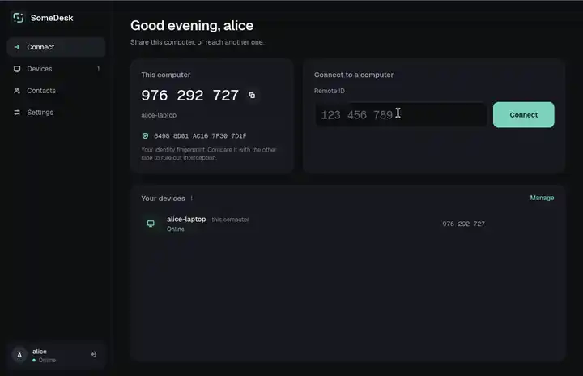
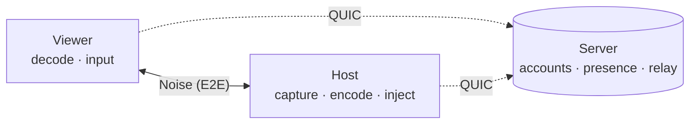

<p align="center">
  <picture>
    <source media="(prefers-color-scheme: dark)" srcset="assets/brand/logo.svg">
    
  </picture>
</p>

<p align="center">
  <b>Remote desktop you host yourself.</b><br>
  End-to-end encrypted sessions, a password the server never sees, written in Rust.
</p>

<p align="center">
  <a href="https://github.com/giosuel/somedesk/actions/workflows/ci.yml"></a>
  <a href="https://github.com/giosuel/somedesk/releases"></a>
  <a href="LICENSE"></a>
  
  
</p>

<p align="center">
  <a href="https://somedesk.giosuel.ch/"><b>Documentation</b></a> ·
  <a href="https://github.com/giosuel/somedesk/releases"><b>Download</b></a> ·
  <a href="docs/self-hosting.md"><b>Self-hosting</b></a> ·
  <a href="docs/security.md"><b>Security model</b></a>
</p>

<p align="center">
  
</p>

## Why SomeDesk

<table>
  <tr>
    <td width="33%" valign="top"><b>Encrypted end to end</b><br>Screen, input, clipboard and files travel in a Noise session between the two computers. The relay only ever sees ciphertext.</td>
    <td width="33%" valign="top"><b>Zero-knowledge sign-in</b><br>OPAQUE login: the server never receives your password. Your identity key is sealed with it, and a recovery key gets you back in.</td>
    <td width="33%" valign="top"><b>Yours to run</b><br>One small server with PostgreSQL, as a container, a <code>.deb</code> or a systemd unit. No accounts with anyone else.</td>
  </tr>
  <tr>
    <td valign="top"><b>Direct when possible</b><br>Peers punch through NATs and connect straight to each other over QUIC, and fall back to the relay within 2.5 s.</td>
    <td valign="top"><b>Knows who's calling</b><br>Identities are remembered like SSH host keys. If a contact's key changes, SomeDesk stops and warns before connecting.</td>
    <td valign="top"><b>Everything you need</b><br>Shared clipboard, files in both directions (checked with SHA-256), a monitor picker, and unattended access for your own devices.</td>
  </tr>
</table>

## Quick start

**1. Run the server** on a machine both computers can reach (UDP port 21116):

```sh
git clone https://github.com/giosuel/somedesk && cd somedesk
SOMEDESK_DB_PASSWORD=change-me docker compose -f packaging/server/compose.yaml up -d
```

**2. Install the app** from the [releases](https://github.com/giosuel/somedesk/releases) on both computers (on Arch Linux, from the AUR: `somedesk` or `somedesk-bin`). Create an account with your server's address, keep the recovery key somewhere safe, and connect using the other computer's nine-digit ID.

See [Self-hosting](docs/self-hosting.md) for the `.deb`, systemd and building from source.

## How it works



Both devices stay connected to your server, which handles accounts and tells them how to reach each other. A session is a Noise handshake between the two devices, either over a direct QUIC connection or relayed through the server. Either way, only the two devices hold the keys. More in [Architecture](docs/architecture.md) and the [Security model](docs/security.md).

## Screenshots

<table>
  <tr>
    <td></td>
    <td></td>
  </tr>
  <tr>
    <td align="center"><sub>The host sees who is calling and their fingerprint</sub></td>
    <td align="center"><sub>Files from the host are only saved once accepted</sub></td>
  </tr>
  <tr>
    <td></td>
    <td></td>
  </tr>
  <tr>
    <td align="center"><sub>A changed identity stops the connection</sub></td>
    <td align="center"><sub>Remembered contacts and unattended access</sub></td>
  </tr>
</table>

## Status

Remote control works end to end on **Linux**, both X11 and Wayland (through the desktop portal). The **Windows** and **macOS** backends are written and pass their tests in CI, but haven't yet been used in real sessions on those systems. The **Android** app connects to and controls your computers (it doesn't share the phone's screen), tested on the Android emulator. See [Platforms](docs/platforms.md).

## Contributing

Issues and pull requests are welcome. [Development](docs/development.md) explains the test suite, which runs a real server, PostgreSQL and two clients.

## License

[AGPL-3.0-or-later](LICENSE).
