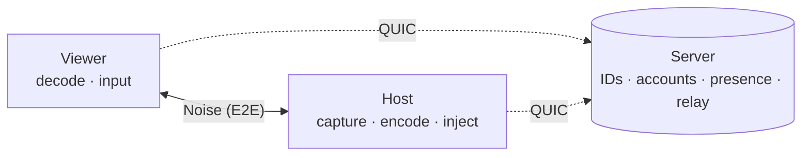
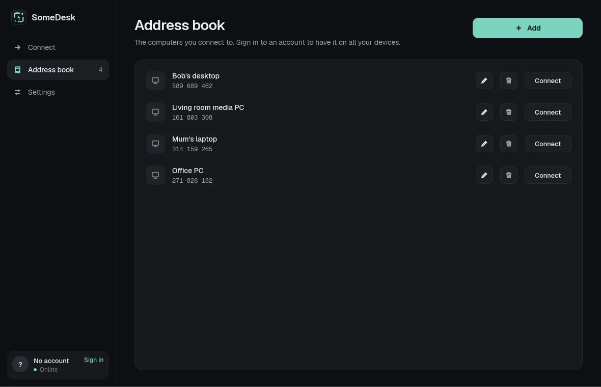

<p align="center">
  <picture>
    <source media="(prefers-color-scheme: dark)" srcset="assets/brand/logo.svg">
    
  </picture>
</p>

<p align="center">
  <b>Remote desktop you host yourself.</b><br>
  Connect by ID, no account needed. End-to-end encrypted, written in Rust.<br>
  <b>Every feature is free, and always will be.</b>
</p>

<p align="center">
  <a href="https://github.com/giosuel/somedesk/actions/workflows/ci.yml"></a>
  <a href="https://github.com/giosuel/somedesk/releases"></a>
  <a href="LICENSE"></a>
  
  
</p>

<p align="center">
  <a href="https://somedesk.giosuel.ch/"><b>Documentation</b></a> ·
  <a href="https://github.com/giosuel/somedesk/releases"><b>Download</b></a> ·
  <a href="docs/connecting.md"><b>Ways to connect</b></a> ·
  <a href="docs/self-hosting.md"><b>Self-hosting</b></a> ·
  <a href="docs/security.md"><b>Security model</b></a>
</p>

<p align="center">
  
</p>

## Free, forever

**Every feature of SomeDesk is free, for everyone, for good.** There is no paid tier, no
"business edition", no licence key and no limit on devices, sessions or members. Unattended
access, two-factor authentication, the synced address book, organisations with enrolled
machines, every platform, commercial use: all free today, and nothing will ever move behind a
payment, nor will anything added later. SomeDesk is [AGPL](LICENSE) software you run on your
own server, so there's nothing to sell you. More in [Free, forever](docs/free.md).

## Why SomeDesk

<table>
  <tr>
    <td width="33%" valign="top"><b>Encrypted end to end</b><br>Screen, input, clipboard and files travel in a Noise session between the two computers. The relay only ever sees ciphertext.</td>
    <td width="33%" valign="top"><b>No account needed</b><br>Every installation gets its own ID, bound to a key that never leaves it. Accounts are optional, and their passwords never reach the server (OPAQUE).</td>
    <td width="33%" valign="top"><b>Yours to run</b><br>One small server with PostgreSQL, as a container, a <code>.deb</code> or a systemd unit. No accounts with anyone else.</td>
  </tr>
  <tr>
    <td valign="top"><b>Direct when possible</b><br>Peers punch through NATs and connect straight to each other over QUIC, and fall back to the relay within 2.5 s.</td>
    <td valign="top"><b>The computer decides</b><br>Someone accepts, or a password plus an authenticator code, or your own devices, or an organisation's signed rules. The server can't let anyone in.</td>
    <td valign="top"><b>Everything you need</b><br>An encrypted, synced address book, saved passwords, clipboard, files both ways, a monitor picker, and a tray icon that keeps you reachable.</td>
  </tr>
</table>

## Quick start

**1. Run the server** on a machine both computers can reach (UDP port 21116):

```sh
curl -O https://raw.githubusercontent.com/giosuel/somedesk/main/packaging/server/compose.yaml
SOMEDESK_DB_PASSWORD=change-me docker compose up -d
```

**2. Install the app** from the [releases](https://github.com/giosuel/somedesk/releases) on both computers (on Arch Linux, from the AUR: `somedesk` or `somedesk-bin`). Enter your server's address, and each computer gets its nine-digit ID. No sign-up.

**3. Connect** with the other computer's ID: the person there accepts. For computers with nobody at them, set up a password and an authenticator code on them, or sign both in to an account. See [Ways to connect](docs/connecting.md).

See [Self-hosting](docs/self-hosting.md) for the `.deb`, systemd and building from source.

## How it works



Both devices stay connected to your server, which gives them their IDs and tells them how to reach each other. Who may connect is decided by the computer being connected to, never by the server. A session is a Noise handshake between the two devices, either over a direct QUIC connection or relayed through the server. Either way, only the two devices hold the keys. More in [Architecture](docs/architecture.md) and the [Security model](docs/security.md).

## Screenshots

<table>
  <tr>
    <td></td>
    <td></td>
  </tr>
  <tr>
    <td align="center"><sub>The host sees who is calling, and decides</sub></td>
    <td align="center"><sub>Files from the host are only saved once accepted</sub></td>
  </tr>
  <tr>
    <td></td>
    <td></td>
  </tr>
  <tr>
    <td align="center"><sub>A changed identity stops the connection</sub></td>
    <td align="center"><sub>The address book, synced end to end encrypted</sub></td>
  </tr>
</table>

## Status

Remote control works end to end on **Linux**, both X11 and Wayland (through the desktop portal). The **Windows** and **macOS** backends are written and pass their tests in CI, but haven't yet been used in real sessions on those systems. The **Android** app connects to and controls your computers (it doesn't share the phone's screen), tested on the Android emulator. See [Platforms](docs/platforms.md).

Organisations enroll machines with `somedesk-agent`, which ships with every package; see [Organisations](docs/organisations.md).

## Contributing

Issues and pull requests are welcome. [Development](docs/development.md) explains the test suite, which runs a real server, PostgreSQL and two clients.

## License

[AGPL-3.0-or-later](LICENSE).
