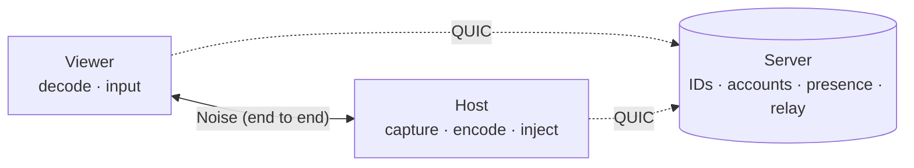
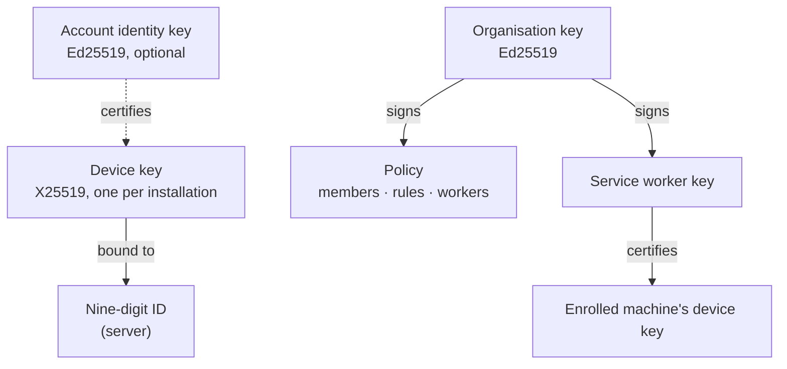

# Architecture

SomeDesk is a Rust workspace: a server, a desktop client, and the libraries they share.

## Overview

The server keeps devices, accounts and organisations in PostgreSQL, tracks who is online and
relays sessions that can't go direct. It never holds a key that could open a session, and it
doesn't decide who may connect: each computer does that itself (see [Ways to connect](connecting.md)).

## Identities

Every installation has its own **device key**, created on first start; the server binds an ID to
it. An **account** is optional: signing in certifies the device key with the account's identity
key, which is what lets your own devices recognise each other. An **organisation** signs its
policy with its own key, and its service workers certify the machines they enroll.

| Crate | Purpose |
|---|---|
| `proto` | Wire types, length-prefixed framing, organisation policies |
| `crypto` | Device keys, OPAQUE (account and unattended access), sealed identity key, certificates, Noise channel, TOTP, the vault, organisation keys |
| `server` | QUIC control protocol, IDs and devices, accounts, vaults, organisations, presence, blind relay (PostgreSQL via sqlx) |
| `client` | Server connection, accounts, address book, keychain, unattended access, organisations, host and viewer session pipelines |
| `codec` | H.264 encode/decode (OpenH264) |
| `platform` | Screen capture, input injection and clipboard (Linux: X11, and Wayland via the desktop portal + PipeWire) |
| `app` | Desktop and Android client (Slint), tray, and `somedesk-agent` for enrolled machines; fonts: Geist / Geist Mono (OFL) |
| `e2e-tests` | Integration tests: real server + PostgreSQL + relay + clients |

## Direct or relayed

When a session starts, the server tells each device where the other can be reached. Both send
a few short-lived packets towards the other, which open their own NAT, and then dial each other
over QUIC. The first direct path to carry the viewer's handshake wins. If none works within 2.5
seconds, the session goes through the server's relay. Either way it's the same Noise session,
so the relay only forwards ciphertext. The [Security model](security.md)
covers the details, including how to turn direct connections off.
