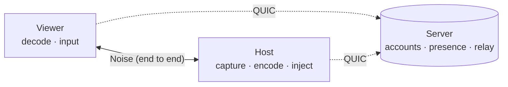

# Architecture

SomeDesk is a Rust workspace: a server, a desktop client, and the libraries they share.

## Overview

The server keeps accounts and devices in PostgreSQL, tracks who is online and relays sessions
that can't go direct. It never holds a key that could open a session.

| Crate | Purpose |
|---|---|
| `proto` | Wire types and length-prefixed framing |
| `crypto` | OPAQUE login, password-sealed identity key, device certificates, Noise channel |
| `server` | QUIC control protocol, device registry, presence, blind relay (PostgreSQL via sqlx) |
| `client` | Server connection, account flows, host and viewer session pipelines |
| `codec` | H.264 encode/decode (OpenH264) |
| `platform` | Screen capture, input injection and clipboard (Linux: X11, and Wayland via the desktop portal + PipeWire) |
| `app` | Desktop client (Slint); fonts: Geist / Geist Mono (OFL) |
| `e2e-tests` | Integration tests: real server + PostgreSQL + relay + clients |

## Direct or relayed

When a session starts, the server tells each device where the other can be reached. Both send
a few short-lived packets towards the other, which open their own NAT, and then dial each other
over QUIC. The first direct path to carry the viewer's handshake wins. If none works within 2.5
seconds, the session goes through the server's relay. Either way it's the same Noise session,
so the relay only forwards ciphertext. The [Security model](security.md)
covers the details, including how to turn direct connections off.
