# Ways to connect

There are four ways onto a computer. Whichever one is used, **the computer you connect to makes
the decision itself**. The server only puts the two in touch, and the session between them is
encrypted end to end.

| | Who can use it | What lets them in | Needs an account |
|---|---|---|---|
| **1. By ID** | Anyone who knows the ID | The person at the computer accepts | No |
| **2. Password and code** | Anyone you gave the password to | The computer's password and a fresh code from its authenticator app | No |
| **3. Your own devices** | Your devices signed in to the same account | You switched it on, and your account has two-factor authentication | Yes |
| **4. Organisation** | Members of an organisation | The organisation's signed rules | Yes, for members |

Every way shows a banner on the computer while someone is connected, with who it is and how
they got in. All four ways are free, like everything else in SomeDesk. [They always will be](free.md).

## 1. By ID

The default, and the only way that works out of the box. Enter the computer's nine-digit ID
and the person there sees who is calling:

- the calling computer's **name** and **ID**,
- if it's signed in, the **account** and its fingerprint, which you can compare with the one in
  their **Settings**,
- a warning if this computer has called before with a **different key**, which would mean it was
  reinstalled or someone is pretending to be it.

They choose **Accept** or **Decline**. There's no "always allow": to let someone in without
asking, set up one of the next three ways.

## 2. Password and code

For a computer you want to reach when nobody is there: your office PC, or a relative's laptop
you look after. Set it up **on that computer**, under **Settings › Getting in without someone
here › Unattended access**:

1. Choose **Set up** and pick a password for this computer.
2. Scan the QR code with an authenticator app, or type the secret into it.
3. Enter the code the app shows, to confirm it works.

To connect, enter the ID, then the password and the current code.

The password is checked with OPAQUE inside the session, so it never travels, not even
encrypted, and the server has nothing to try passwords against. Each code works once. After
three wrong attempts the computer stops answering for 30 seconds, then twice as long after each
further mistake, up to an hour. **Change** sets a new password and code, and **Turn off**
removes them.

### Saving the password

After connecting, you can save the password:

- **On this device:** in your system's keychain (Secret Service on Linux, Credential Manager on
  Windows, Keychain on macOS). Not offered where there's no keychain.
- **In your account:** encrypted on your device with a key from your account, then synced with
  your address book. The server can't read it.
- **Don't save.**

The code from the authenticator app is never saved: it would defeat the point of having two.

## 3. Your own devices

When you're signed in on several computers, they can reach each other without anyone
accepting. Because that's a lot of trust to hand to a single account password, it's **off by
default** and needs two things:

- two-factor authentication on your account (**Settings › Account**), and
- **Settings › Getting in without someone here › My own devices**, switched on on each computer
  you want to reach this way.

The computer checks that the caller's key was certified by your account, and asks the server
whether that device still belongs to the account, so a device you removed under **My devices** is
out straight away. If you turn off two-factor authentication, this way closes until you turn it
on again.

## 4. Organisation

For teams that look after many machines. An admin creates a service worker key, which enrolls
machines into the organisation, and decides which members reach which machines. Enrolled
machines run a small background agent: they have no ID to call, no password, and never start a
session themselves. See [Organisations](organisations.md).
