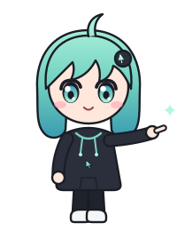
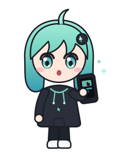
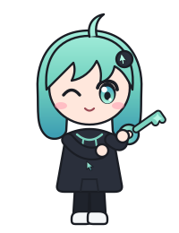
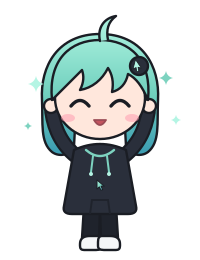
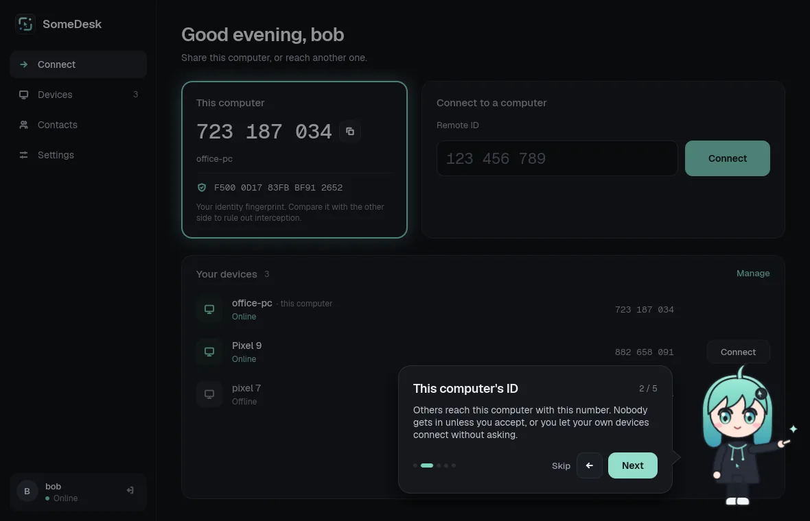

<h1 class="sd-hero__title">Your computers, within reach.</h1>

SomeDesk is a self-hosted remote desktop. Sessions are encrypted end to end, the server never sees your password, and it's written in Rust.

  
  
  
  
  

  <a class="sd-button sd-button--primary" href="getting-started/">Get started</a>
  <a class="sd-button" href="https://github.com/giosuel/somedesk"><svg width="16" height="16" viewBox="0 0 16 16" fill="currentColor" aria-hidden="true"><path d="M8 0C3.58 0 0 3.58 0 8c0 3.54 2.29 6.53 5.47 7.59.4.07.55-.17.55-.38 0-.19-.01-.82-.01-1.49-2.01.37-2.53-.49-2.69-.94-.09-.23-.48-.94-.82-1.13-.28-.15-.68-.52-.01-.53.63-.01 1.08.58 1.23.82.72 1.21 1.87.87 2.33.66.07-.52.28-.87.51-1.07-1.78-.2-3.64-.89-3.64-3.95 0-.87.31-1.59.82-2.15-.08-.2-.36-1.02.08-2.12 0 0 .67-.21 2.2.82.64-.18 1.32-.27 2-.27.68 0 1.36.09 2 .27 1.53-1.04 2.2-.82 2.2-.82.44 1.1.16 1.92.08 2.12.51.56.82 1.27.82 2.15 0 3.07-1.87 3.75-3.65 3.95.29.25.54.73.54 1.48 0 1.07-.01 1.93-.01 2.2 0 .21.15.46.55.38A8.013 8.013 0 0016 8c0-4.42-3.58-8-8-8z"/></svg>View on GitHub</a>
  <a class="sd-button" href="https://github.com/giosuel/somedesk/releases">Download</a>

  
  

<h2 class="sd-section-title">Built for privacy, not around it</h2>

Everything that matters happens between your two computers. Your server connects them, and that's all.

  

    <svg viewBox="0 0 24 24" fill="none" stroke="currentColor" stroke-width="2" stroke-linecap="round" stroke-linejoin="round"><path d="M8 11V8a4 4 0 0 1 8 0v3 M6 11h12a1 1 0 0 1 1 1v8a1 1 0 0 1-1 1H6a1 1 0 0 1-1-1v-8a1 1 0 0 1 1-1z"/></svg>
    <h3>Encrypted end to end</h3>
    
Screen, input, clipboard and files travel in a Noise session between the two computers. The relay only ever forwards ciphertext.

  

  

    <svg viewBox="0 0 24 24" fill="none" stroke="currentColor" stroke-width="2" stroke-linecap="round" stroke-linejoin="round"><path d="M8 20a4 4 0 1 0 0-8a4 4 0 0 0 0 8z M11 13l9-9 M16 8l3 3 M14 10l2 2"/></svg>
    <h3>Zero-knowledge sign-in</h3>
    
OPAQUE login means the server never receives your password. Your identity key is sealed with it, and a recovery key gets you back in.

  

  

    <svg viewBox="0 0 24 24" fill="none" stroke="currentColor" stroke-width="2" stroke-linecap="round" stroke-linejoin="round"><path d="M5 4h14a1 1 0 0 1 1 1v4a1 1 0 0 1-1 1H5a1 1 0 0 1-1-1V5a1 1 0 0 1 1-1z M5 14h14a1 1 0 0 1 1 1v4a1 1 0 0 1-1 1H5a1 1 0 0 1-1-1v-4a1 1 0 0 1 1-1z M8 7h.01 M8 17h.01"/></svg>
    <h3>Yours to run</h3>
    
One small server with PostgreSQL: a container, a <code>.deb</code> or a systemd unit. No third-party accounts, no telemetry.

  

  

    <svg viewBox="0 0 24 24" fill="none" stroke="currentColor" stroke-width="2" stroke-linecap="round" stroke-linejoin="round"><path d="M10 14a4 4 0 0 0 5.7 0l3-3a4 4 0 0 0-5.7-5.7l-1 1 M14 10a4 4 0 0 0-5.7 0l-3 3a4 4 0 0 0 5.7 5.7l1-1"/></svg>
    <h3>Direct when possible</h3>
    
Peers punch through NATs and connect straight to each other over QUIC. If that fails, they fall back to the relay within 2.5 seconds.

  

  

    <svg viewBox="0 0 24 24" fill="none" stroke="currentColor" stroke-width="2" stroke-linecap="round" stroke-linejoin="round"><path d="M12 11v3 M8.5 8.5a5 5 0 0 1 8.5 3.5v1.5 M7 12.5v1a5 5 0 0 0 2.5 4.3 M15 17a4 4 0 0 1-.6 2.5 M4.5 9a8.5 8.5 0 0 1 15 2"/></svg>
    <h3>Knows who's calling</h3>
    
Identities are remembered like SSH host keys. If a contact's key changes, SomeDesk stops and warns before connecting.

  

  

    <svg viewBox="0 0 24 24" fill="none" stroke="currentColor" stroke-width="2" stroke-linecap="round" stroke-linejoin="round"><path d="M9 3h6v4H9z M9 5H6a1 1 0 0 0-1 1v14a1 1 0 0 0 1 1h12a1 1 0 0 0 1-1V6a1 1 0 0 0-1-1h-3"/></svg>
    <h3>Everything you need</h3>
    
Shared clipboard, files in both directions (checked with SHA-256), a monitor picker, and unattended access for your own devices.

  

<h2 class="sd-section-title">Up and running in minutes</h2>

One server, any number of computers.

### Run the server

Start it with Docker Compose on a machine both computers can reach (UDP 21116).

### Install the app

Get it for Linux, Windows, macOS or Android from the [releases](https://github.com/giosuel/somedesk/releases), and create an account on your server.

### Connect

Enter the other computer's nine-digit ID. The person there sees who you are and accepts.

<h2 class="sd-section-title">A closer look</h2>

  <figure class="sd-shot"><figcaption>The host sees who is calling and their fingerprint.</figcaption></figure>
  <figure class="sd-shot"><figcaption>Remote control, with the route, latency and frame rate in view.</figcaption></figure>
  <figure class="sd-shot"><figcaption>Files from the host are only saved once you accept them.</figcaption></figure>
  <figure class="sd-shot"><figcaption>A changed identity stops the connection before it starts.</figcaption></figure>

  

    <h2>Meet Desi</h2>
    
The first time you sign in, Desi shows you around: your ID, how to reach your other computers, and what keeps your sessions private. Five quick steps, and she's always one click away in Settings.

    

      
      
      
      
      
    

  

  <figure class="sd-shot sd-meet__shot"><figcaption>The welcome tour on the desktop. On a phone, Desi stands on the bottom card.</figcaption></figure>

## Take back your remote desktop

SomeDesk is free software under the AGPL. Read how it keeps sessions private, or set up your own server.

  <a class="sd-button sd-button--primary" href="self-hosting/">Self-hosting guide</a>
  <a class="sd-button" href="security/">Security model</a>

