# Organisations

For a company, a school or an IT team that looks after many machines. Every part of it is free,
with no limit on members or machines: SomeDesk has [no paid plans](free.md).

An organisation has **members** (accounts on your server) and **enrolled machines**. Admins
decide which members may reach which machines. The machines check those rules themselves, so
nobody, not even the server, can let someone in that the admins didn't allow.

## Create an organisation

Organisations need an account. Open **Organisations** in the sidebar, give it a name and choose
**Create**. You're its first admin. Admin actions are signed with the organisation's key, which
your account's key unlocks, so the app asks for your password the first time you change
something.

Then, under the organisation:

- **Members:** add accounts by username, each to a group such as *Support*. Tick **Admin** to let
  them change all of this too. The app shows the member's fingerprint: compare it with theirs to
  be sure the server gave you the right person. The organisation shows up for them as an
  invitation: they **Join** it to see its devices, or **Decline** it, and then it's gone from
  their list.
- **Who reaches which devices:** rules from a member group to a device group. `*` means every
  enrolled machine, or name a device group, listing machines by their IDs. The app looks up the
  key each machine was enrolled with and puts that in the rules, so the server can't move another
  machine under an ID.
- **Service workers:** keys that enroll machines (next section). A key can be **revoked**, which
  stops it from enrolling any more machines; machines it already enrolled stay in.

Removing an admin also replaces the organisation's key, since their copy would otherwise still
sign rules. The app does that by itself: the remaining admins get the new key, and the machines
switch to it with their next update. Enrollment keys made before keep working.

## Enroll machines

**Create key** under **Service workers** shows an enrollment key (`sdw1-…`). Copy it to the
machine (it's a secret, like a password), install SomeDesk there, and run:

```sh
SOMEDESK_ENROLLMENT_KEY=sdw1-… somedesk-agent enroll --server desk.example.com
somedesk-agent install-service   # start in the background at login
somedesk-agent status            # its ID and organisation
```

`somedesk-agent` comes with every SomeDesk package. The key can also be passed as `--key sdw1-…`,
but the environment variable keeps it out of the process list, and `--name` overrides the
machine's name (its hostname by default). `install-service` sets up a
systemd user unit on Linux, a Run key on Windows and a LaunchAgent on macOS. To run it in the
foreground instead, use `somedesk-agent run`.

An enrolled machine:

- appears under the organisation's **Devices**, where members connect to it,
- can't be reached by its ID or a password, and never starts a session itself,
- lets in a member only when the organisation's current rules allow it, from a device that is
  still on that member's account (one taken off it, a stolen laptop say, doesn't get in),
- always shows a banner at the top of the screen while someone is connected, with a
  **Disconnect** button.

## Why the server can't add anyone



The members, groups, rules and service workers form a **policy** that admins sign with the
organisation's key. The server stores the policy and hands it to the machines, but doesn't
have the key, so it can't change it. Every enrolled machine got the organisation's public key
in its enrollment key, and checks the signature before using a policy.

Machines never accept an older version than the one they already have, and every policy
expires after 30 days. An admin's app renews it once they've unlocked the organisation with their password, so an
admin should open it at least once a month. A machine with an expired policy
lets nobody in until it gets a fresh one.

The organisation's key is kept on the server only sealed to each admin's own key, and signed by
the admin who sealed it. Adding an admin seals a copy for them; the server can't open any of the
copies, nor seal a key of its own and pass it off as the organisation's. When you open an
organisation for the first time, the app tells you who shared its key with you, and checks them
against the key it knows for that account. From then on your account remembers the
organisation's key and newest policy, on all of its devices, and refuses another key or an older
policy.

Two limits to know about. The server can always keep things *out*: it can hold back a new
policy from a machine (until the old one expires) or stop delivering an organisation. And a
machine that hasn't been online since an admin was removed still trusts the old key until it
hears of the new one.
