# Platforms

## Support

| Host platform | Capture | Input | Verified |
|---|---|---|---|
| Linux X11 | XGetImage, RandR monitors | XTest | end to end (tests + manual) |
| Linux Wayland: GNOME, KDE | xdg-desktop-portal + PipeWire | portal RemoteDesktop | end to end in headless GNOME |
| Linux Wayland: Hyprland, Sway, river, … | xdg-desktop-portal + PipeWire | virtual pointer + keyboard protocols | input end to end in headless Sway (tests); not yet on Hyprland itself, nor capture on these desktops |
| Windows | GDI BitBlt, all monitors | SendInput | backend tests pass under Wine; app UI runs under Wine; networking needs real Windows (Wine lacks `IP_RECVECN`, which QUIC uses) |
| macOS | CoreGraphics display images | CGEvent | compile-checked only |

Windows builds use the MinGW toolchain (`x86_64-pc-windows-gnu`); ship `libstdc++-6.dll`,
`libgcc_s_seh-1.dll` and `libwinpthread-1.dll` next to `somedesk.exe`. On macOS the user must allow
*Screen Recording* (required) and *Accessibility* (for control; otherwise view-only). Neither
covers the login screen or UAC prompts yet; that needs a system service / launch daemon.

## Background and tray

Closing the window leaves SomeDesk running, so the computer stays reachable
(**Settings › Keep running in the background**). Only one copy runs at a time: starting it again
brings the window back.

| Desktop | Where it lives |
|---|---|
| KDE Plasma, Cinnamon, XFCE, Budgie and others | the system tray (StatusNotifierItem) |
| GNOME | the tray with the [AppIndicator extension](https://extensions.gnome.org/extension/615/appindicator-support/) (included on Ubuntu); otherwise it runs without an icon |
| Windows | the notification area of the taskbar |
| macOS | the menu bar |

**Start when I log in** adds an autostart entry (`~/.config/autostart` on Linux, the Run key on
Windows, a LaunchAgent on macOS) that starts it with `--background`. The tray has been tested on
Linux only so far.

## Saved passwords

Passwords saved "on this device" go to the system keychain: the Secret Service (GNOME Keyring,
KWallet) on Linux, the Credential Manager on Windows and the Keychain on macOS. Where none is
running, as on some minimal desktops, that option isn't offered, and a signed-in device can save
to its account instead. Android has no keychain support yet.

## Android

The Android app (Android 8 and newer) connects to computers; it does not share the phone's
screen. It uses the phone layout of the same UI: bottom navigation, and a full-screen session
where a tap clicks, a long press right-clicks and dragging drags. A scroll mode turns dragging
into the mouse wheel, and the keyboard button opens the soft keyboard with a row of Esc, Tab,
Ctrl, Alt, arrows, Delete, Home, End and Super. A hardware keyboard works as on the desktop.
Back ends a session, and leaves the app from the home screen.

The clipboard is shared through Android's clipboard manager. Android only lets the app read it
while it is in front, so text copied on the phone reaches the computer once SomeDesk is open again.
Sending files from the phone isn't supported yet; received files are saved to *Download/SomeDesk*
(not yet tested).

The phone reaches computers by ID, with a password and code, or as your own device. It can't be
reached itself, so it has no unattended access of its own.

Verified on the Android 15 emulator (x86_64): sign-in, sessions over a direct connection, touch
input, typing through Gboard, scrolling, rotation and the clipboard from the computer. Not yet
tried on a physical phone.

## Linux desktops

The host picks its backend from the session: **X11** (XGetImage + XTest; RandR monitors can be
viewed one at a time), or on **Wayland** the
**xdg-desktop-portal** (`RemoteDesktop` + `ScreenCast`, frames over PipeWire).
`SOMEDESK_BACKEND=x11|portal` overrides the choice.

On Wayland the desktop itself asks the person at the host for permission the first time someone
connects (after they accepted in SomeDesk). They choose *Share* and switch on *Allow Remote
Interaction*; SomeDesk tells them so. The portal's restore token is stored next to the device
credentials, so later sessions start without asking again.

**Hyprland, Sway and other wlroots-style desktops** have a portal for the screen
(`xdg-desktop-portal-hyprland`, `xdg-desktop-portal-wlr`) but none for remote input. There,
SomeDesk sends the viewer's mouse and keyboard through the compositor's virtual pointer and
virtual keyboard protocols, as wayvnc does. The virtual keyboard brings its own keymap, built as
keys come in, so the viewer can type any character whatever the host's keyboard layout. The
pointer is tied to the monitor the portal shares. On Hyprland with
`ecosystem:enforce_permissions` on, allow SomeDesk's virtual keyboard when Hyprland asks.

If remote interaction is not allowed, or the desktop offers neither way, the screen is shared
view-only: the person at the host is told why, and the viewer sees *View only* in its toolbar.

Known gaps: screen capture on wlroots desktops is untested (their portals can't capture a
GPU-less headless compositor), and Hyprland itself is only covered by its protocols being the
ones the Sway test uses. Clipboard sharing on GNOME Wayland goes through XWayland, since GNOME
does not offer the Wayland data-control protocol.
